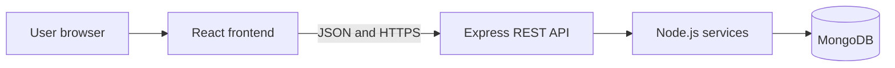
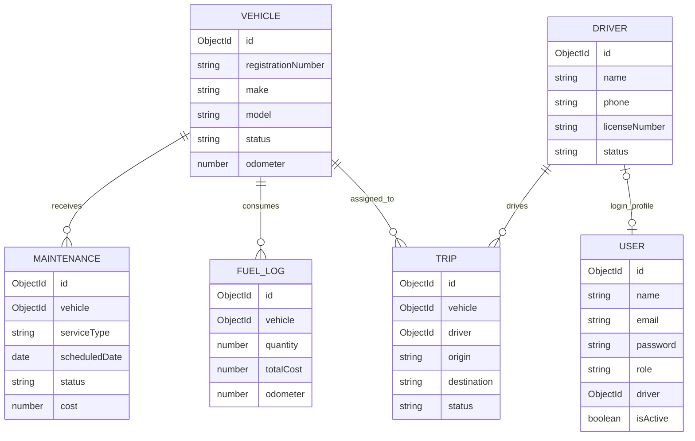

# Combined Review Guide

## Review 1 coverage

### Functional requirements

1. Users can log in securely.
2. Administrators manage user accounts and all fleet records.
3. Fleet managers create and update operational records without destructive administrator access.
4. Drivers view only their assignments, update trip progress, and submit fuel entries.
5. The system maintains vehicles, drivers, trips, fuel entries, and maintenance.
6. The dashboard displays live totals, monthly costs, utilization, and compliance alerts.
7. Reports compare utilization, fuel cost, and maintenance cost.
8. Users can export the operational report as CSV.

### Non-functional requirements

- Security: hashed passwords, JWT authentication, and role permissions.
- Usability: consistent navigation, validation, readable forms, and status badges.
- Performance: indexed MongoDB identifiers and parallel dashboard queries.
- Reliability: server validation and centralized error handling.
- Maintainability: separate models, controllers, routes, components, and configuration.
- Responsiveness: desktop, tablet, and mobile layouts.

### System architecture

### Use case diagram content

Actors:

- Administrator
- Fleet manager
- Driver

Use cases:

- Log in
- Manage users
- Manage vehicles
- Manage drivers
- Create and update trips
- Record fuel usage
- Schedule maintenance
- View dashboard
- Generate and export reports

Administrator can access every use case. Fleet manager can manage operational records and reports. Driver access can be restricted to assigned trips and personal records.

### ER diagram content

### Module descriptions

| Module | Main responsibility |
| --- | --- |
| Authentication | Login, JWT creation, and role permission checks |
| User Management | Admin account creation, activation, roles, and driver linking |
| Dashboard | Fleet totals, cost charts, utilization, recent trips, and alerts |
| Driver Workspace | Personal assignments, trip status, distance, and fuel submission |
| Vehicles | Vehicle identity, type, status, odometer, and insurance |
| Drivers | Contact, licence validity, and availability |
| Trips | Vehicle and driver assignment, route, distance, and status |
| Fuel | Quantity, price, calculated total, vendor, and odometer |
| Maintenance | Service schedule, overdue status, cost, and service history |
| Reports | Vehicle wise utilization and cost comparison with CSV export |

### UI design screens

- Login screen
- Dashboard
- User management
- Driver workspace
- Vehicle table and form
- Driver table and form
- Trip table and assignment form
- Fuel log table and form
- Maintenance table and form
- Operational report

## Review 2 coverage

### Frontend development

React components, React Router navigation, Axios API calls, reusable CRUD page, modal forms, responsive CSS, validation, tables, status badges, and CSV export.

### Backend development

Express server, authentication controller, user controller, driver portal controller, generic CRUD controller, dashboard analytics aggregation, middleware, validation, and centralized error responses.

### Database integration

Mongoose schemas connect the API to MongoDB. Reference fields connect trips to vehicles and drivers, while fuel and maintenance records reference vehicles.

### API development

REST APIs provide create, read, update, and delete operations. JWT middleware protects private endpoints, and role middleware restricts modifications.

### Module-wise implementation status

| Module | Status |
| --- | --- |
| Authentication | Complete |
| User management and roles | Complete |
| Dashboard | Complete |
| Driver workspace | Complete |
| Vehicles | Complete |
| Drivers | Complete |
| Trips | Complete |
| Fuel | Complete |
| Maintenance | Complete |
| Reports and CSV export | Complete |
| Live GPS | Future scope |

### Screenshots to capture

1. Login page
2. Dashboard with seeded data
3. User management and role form
4. Driver workspace
5. Vehicle list
6. Add vehicle form
7. Driver list
8. Trip assignment form
9. Fuel records
10. Maintenance records
11. Reports page
12. MongoDB Compass or Atlas collections
13. Postman API response for login or vehicles

### Progress statement

The application contains all planned core modules. Remaining work is final testing, screenshot collection, documentation polishing, and optional improvements. Report the exact percentage based on what you personally test before the review.

### Challenges faced

- Designing relations between MongoDB collections.
- Protecting APIs using JWT and roles.
- Populating vehicle and driver details in trip responses.
- Keeping reusable forms flexible across different modules.
- Handling frontend and backend connection errors.
- Calculating fuel totals consistently on the server.
